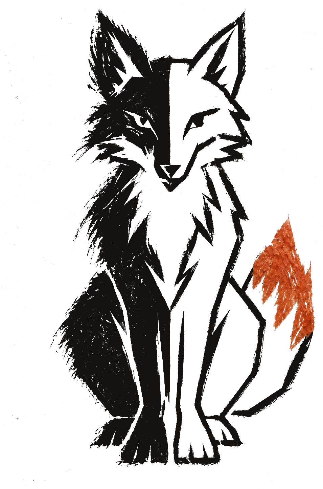

<p align="center">
  
</p>

<h1 align="center">Kurambit</h1>

<p align="center">
  <strong>A game studio that plays what it builds.</strong><br />
  Open source · local first · bring your own coding agent
</p>

<p align="center">
  <a href="https://kurambit.com/">Website</a> ·
  <a href="./docs/user/making-games.md">Making games</a> ·
  <a href="./docs/README.md">Docs</a>
</p>

---

Kurambit is a desktop app for making games with coding agents. Describe a game, and the agent you
already use (Codex, Claude Code, Cursor, Grok Build, OpenCode, or Antigravity) builds it with real
production tools: Blender for models, Godot and Unity for native games and three.js for quick browser games.
You play the result inside the app, ask for changes in plain language, and export a build.

What sets it apart is the loop around the model. Kurambit plays every build with a separate tester
session, compares builds blind so a worse one never lands, and stops when the game is done or stops
getting better.

## What it does

- **New game from a brief.** Name, folder, brief, optional art direction, and the agent and model
  to use. Kurambit scaffolds a portable project and starts its production run on the brief.
- **A production loop that plays its own builds.** Every new game is made by a run: the harness builds,
  plays every build with a separate tester session, compares builds blind so a worse one never
  lands, and stops when the game is done or stops getting better.
- **Real tools, one execution system.** Agents reach Blender, Godot and Unity through Kurambit's own
  `game_*` tools in the app's MCP server, which every provider session already gets. Nothing to
  configure per agent.
- **Assets you can edit.** Each Blender asset keeps its `.blend` source and the script that made it.
  The engine-ready `.glb` is exported into the Godot project.
- **Play, revise, export.** Play the real build in the app, rebuild, and export Windows, Linux and
  web builds. Follow-up requests ("make the rocks taller") revise the same sources and exports.

## Requirements

- Linux x86_64 (the platform this build targets and is tested on).
- At least one coding agent installed and signed in, for example `codex login` or
  `claude auth login`. OpenCode and others can be enabled in **Settings → Providers**.
- Blender and Godot. Kurambit installs pinned, checksum-verified copies for you from the Game panel
  or **Settings → General → Game tools**: Blender 4.5.14 LTS and Godot 4.7.2 (with its export
  templates), into `~/.local/share/kurambit/tools`. You can point it at your own executables instead.
- `uvx` (or `uv`) on PATH for the live Blender view behind the `game_blender_*` tools. The
  **Install tools** button does not install it; get it from https://docs.astral.sh/uv/.

<a id="run-it"></a>

## Run it

From this checkout:

```bash
vp i                  # install dependencies
vp run dev:desktop    # Kurambit desktop app (development build)
```

`vp run dev` serves the same UI in a browser instead. Development state lives in the checkout's
gitignored `.kurambit` directory. An installed build keeps its state in `~/.kurambit`
(override with `KURAMBIT_HOME`).

## Game project layout

```
<game>/
  game.json        manifest: brief, art direction, engine version, assets
  BRIEF.md         brief and art direction, editable
  AGENTS.md        instructions for the agent working on this game
  art/blender/     editable .blend sources
  godot/           the Godot 4.7 project (scenes, scripts, exported .glb models)
  builds/          web, Windows and Linux exports and operation logs (gitignored)
  .studio/         production run rounds, notes, bots and videos
```

Each game is its own git repository, so it can be opened, moved, and continued anywhere Kurambit
runs.

## Documentation

- [Making games](./docs/user/making-games.md)
- [Architecture](./docs/internals/overview.md) and [game layer](./docs/internals/game-layer.md)
- [Development](./docs/operations/development.md)

## License

MIT. See [LICENSE](./LICENSE). Third-party notices are kept in the app's open source license view.
